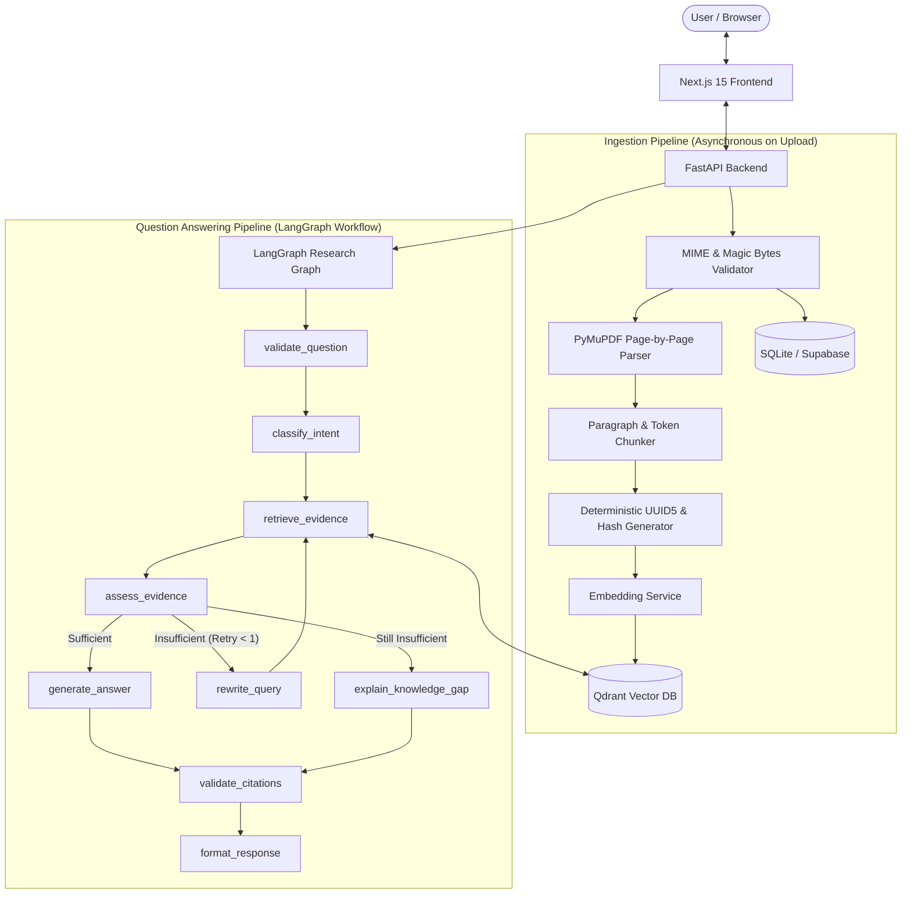

# NEXUS AI — System Architecture Specification

## 1. High-Level System Architecture

Nexus AI decouples the asynchronous **Document Ingestion Pipeline** from the synchronous **Agentic Question Answering Pipeline**.

## 2. Component Design

### 2.1 PyMuPDF Ingestion Engine (`backend/app/ingestion/`)
- Page-by-page text extraction preserves exact 1-based page numbers.
- Whitespace normalization preserves paragraph boundaries.
- Empty/scanned PDF detection: if total extracted text is below 50 characters, the document is flagged with status `failed` and prompt for OCR.

### 2.2 Text Chunker
- Targets 700 tokens per chunk with 100 tokens overlap.
- Paragraph preservation avoids breaking mid-sentence across logical boundaries.
- Computes SHA-256 hash of chunk content for deterministic point ID generation in Qdrant.

### 2.3 Vector & Dense Storage (`backend/app/retrieval/`)
- Qdrant collection `nexus_documents` configured with Cosine distance.
- Uses `qdrant-client` 1.20+ `query_points` API.
- Stores metadata payload: `chunk_id`, `document_id`, `page_number`, `chunk_index`, `title`, `text`, `owner_id`.
- Scoped multi-tenant queries enforce `owner_id` and optional `document_id` filtering.

### 2.4 Controlled LangGraph Workflow (`backend/app/agents/`)
- The LLM does not execute arbitrary code or shell commands.
- State is strictly typed using `AgentState(TypedDict)`.
- Conditional branching handles bounded retrieval retries without infinite loops.
- Emits real-time activity steps to the frontend ("Searching documents", "Checking sources").

### 2.5 Strict Citation Validation
- Post-generation verification matches each cited source ID and quoted excerpt against the actual retrieved chunks.
- Invalid citations or hallucinated page numbers are stripped or replaced with valid source evidence.
